# GatherGo

**Find your ride. Make a friend.**

GatherGo helps University of Oklahoma students get to events together. Swipe on events you want to go to, say whether you're driving or need a ride, and get matched with Sooners going your way. Gas is split fairly (suggested, never charged), and every trip can turn into a friendship.

Built for **SASE Hacks for Good**. Only `@ou.edu` accounts can sign up.

<p>
  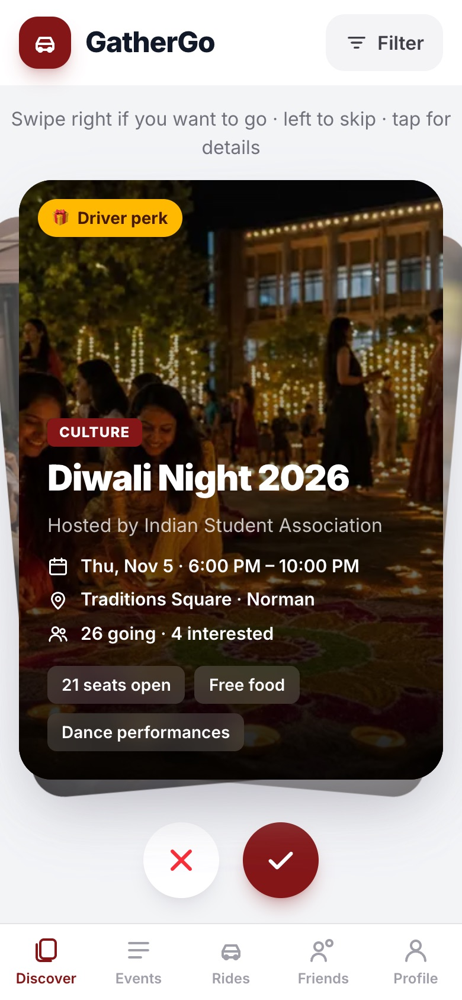
  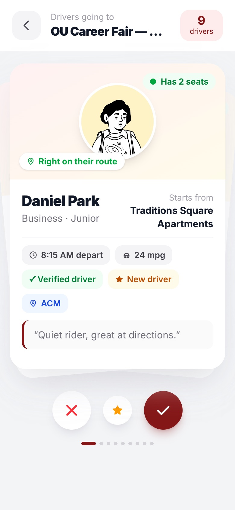
  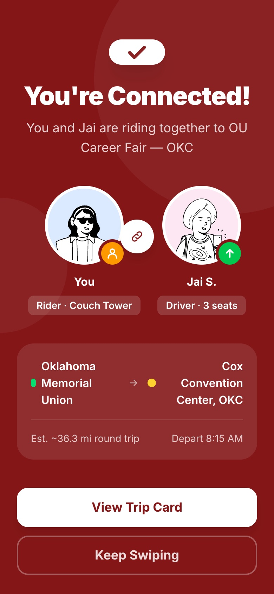
  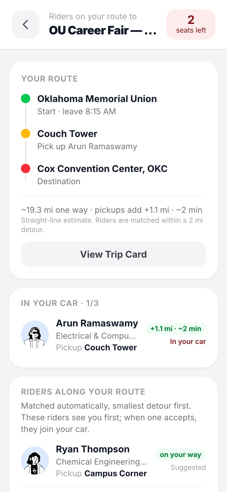
</p>

## How it works

1. **Sign in** with your OU email. Anything that isn't `@ou.edu` is rejected by the app and by the database.
2. **Discover** events by swiping: right = going, left = skip, tap to flip a card for details. First-time users get a short animated tutorial.
3. **Register** for the event. Events with an external sign-up link open it; others RSVP in the app.
4. **How are you going?**
   - **Drivers** enter seats, mpg, their **starting location** and departure time, and choose whether to split gas.
   - **Riders** enter a **pickup spot** and departure time.
5. **Matching is automatic and route based.**
   - **Drivers don't pick riders.** They see *Riders on your route*: riders whose pickup adds only a small detour to the trip from their start to the event, smallest detour first.
   - **Riders only see drivers** whose route passes near them. A rider's right swipe on an on-route driver joins the car instantly, and both sides see **You're Connected!**
6. **Trip card:** the crew, pickup stops in driving order, arrival estimate, gas split, and **Add All** to send friend requests.
7. **After drop off,** riders rate their driver. Ratings show on Rides, person cards and trip cards.

## Screenshots

Screenshots of the running app with seeded demo data (phone size, 390 px).

| Sign in | Discover | Card details (tap to flip) |
| :---: | :---: | :---: |
| 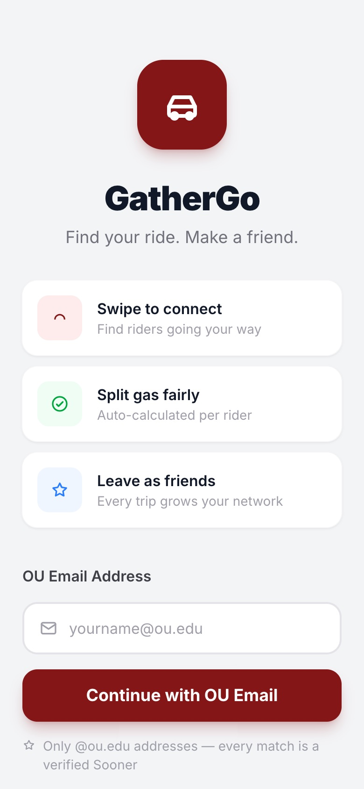 |  | 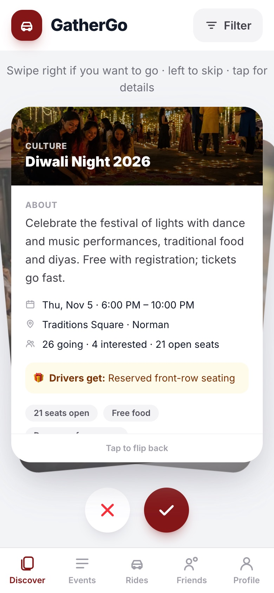 |
| **Register for the event** | **How are you going? (driver)** | **Driver: riders on your route** |
| 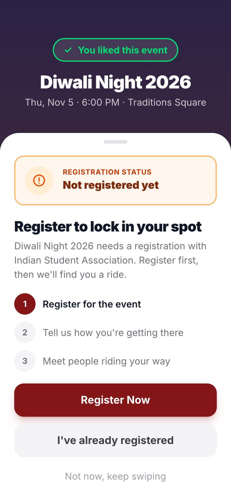 | 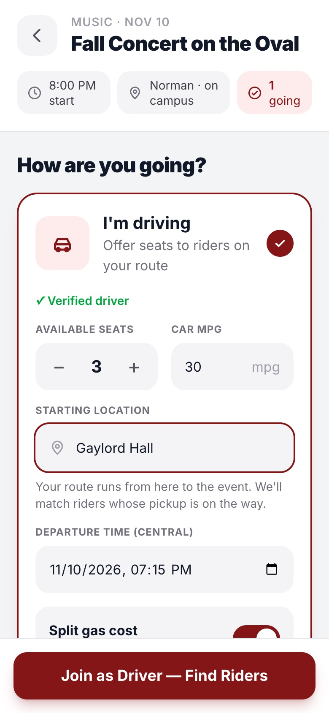 |  |
| **Rider: drivers on your route** | **You're Connected!** | **Trip card and gas split** |
|  |  | 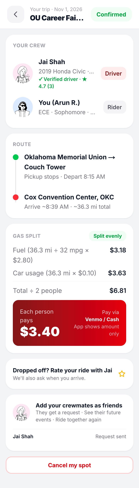 |
| **Events** | **Rides** | |
| 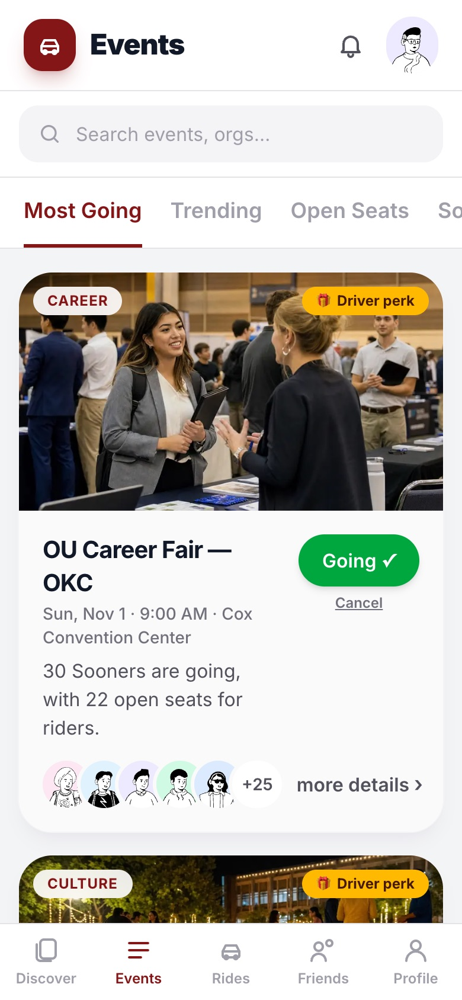 | 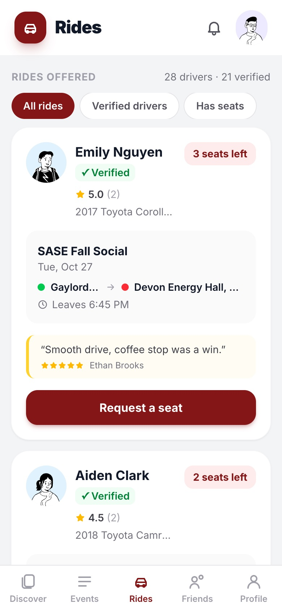 | |

On desktop (1280 px), the bottom tabs become a top navbar and lists become grids:

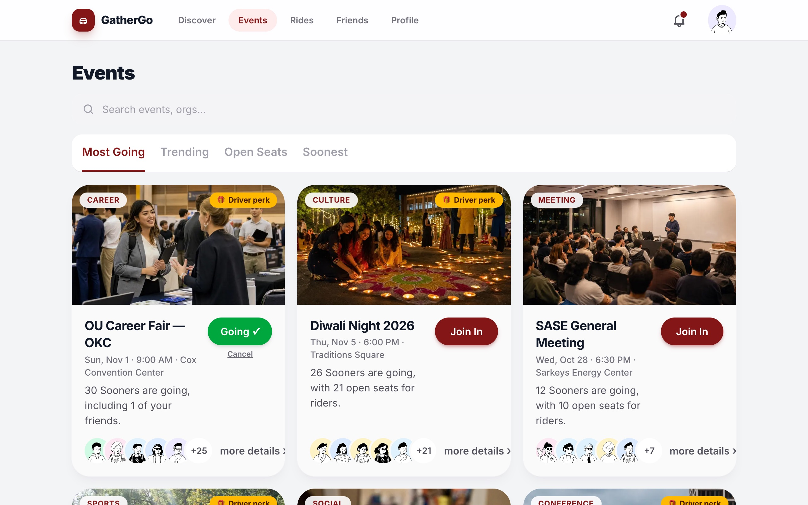

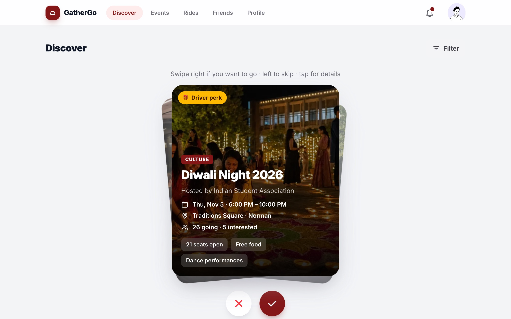

## Features

| Area | What you get |
| --- | --- |
| **Discover** | Photo event cards with GOING / SKIP stamps, a stacked deck, tap to flip, category filter, trending pill, and reason chips ("3 friends going", "Popular with CS majors", open seats) |
| **Events** | Search, sort tabs (Most Going, Trending, Open Seats, Soonest), photo cards with Join In / Going ✓ / Cancel, attendee avatars, a details popup |
| **Rides** | Every driver going to an upcoming event, with a verified badge, ★ rating, car, route, seats left and their latest review. Filter by verified drivers or open seats. Shows your rides and recent reviews |
| **Matching** | Route based (start → pickups → event) with a configurable max detour. Riders consent by swiping; drivers accept automatically. A database trigger prevents overfilling a car |
| **Trip card** | Crew, ordered pickup stops, arrival estimate, gas split (or "Free ride"), friend requests, rider reviews, Cancel my spot / Cancel trip |
| **Social** | Friend requests (accept / decline), friends list, event recommendations, a notifications bell with an unseen dot |
| **Driver trust** | Plate and license verification step, required before driving (see [limitations](#known-limitations)) |
| **Demo tools** | Reset demo button (resets only the signed-in account), `npm run seed`, `npm run demo:match` |
| **Responsive** | Mobile first with bottom tabs; at 768 px and up, a top navbar and grid layouts |

## Tech stack

- **Next.js 16** (App Router, Cache Components, Server Actions) with **TypeScript** (strict)
- **Tailwind CSS v4**
- **Supabase**: email + password auth, Postgres, row level security
- **framer-motion** for swipe gestures
- **DiceBear Notionists** avatars (CC0, generated locally)
- **Vitest** for unit tests

> This repo uses Next.js 16, which changed APIs from earlier versions (for example `proxy.ts` replaces middleware, and pages are kept alive with React `<Activity>`). See [AGENTS.md](AGENTS.md) before changing framework code.

## Getting started

### 1. Install

```bash
npm install
```

Requires Node.js 20+.

### 2. Create a Supabase project

In the Supabase dashboard:

1. **Authentication → Providers → Email:** enabled.
2. **Authentication → Settings:** turn off **Confirm email**, so demo sign-ups work instantly.
3. **SQL Editor:** run these files in order. Each is safe to run again.

| File | Adds |
| --- | --- |
| `supabase/schema.sql` | Core tables, popularity view, row level security |
| `supabase/auth_trigger.sql` | Rejects non `@ou.edu` emails at sign-up |
| `supabase/m4.sql` | Event details, registration, starred swipes, skipped events, the seat limit trigger |
| `supabase/m5.sql` | Friend requests, reviews and ratings, driver perks, driver verification, event descriptions |
| `supabase/m6.sql` | Event photos |

### 3. Environment variables

Create `.env.local` (never commit it):

```bash
NEXT_PUBLIC_SUPABASE_URL=your_project_url
NEXT_PUBLIC_SUPABASE_ANON_KEY=your_anon_key
SUPABASE_SERVICE_ROLE_KEY=your_service_role_key   # server only, never exposed to the browser
NEXT_PUBLIC_GAS_PRICE=2.80                          # $ per gallon, for the gas split
NEXT_PUBLIC_USAGE_RATE=0.10                         # $ per mile for car wear
NEXT_PUBLIC_MAX_DETOUR_MILES=2                      # optional: max detour for rider matching
```

### 4. Seed and run

```bash
npm run seed   # demo accounts, 40 crowd users, events, attendance, reviews
npm run dev    # http://localhost:3000
```

The seed is safe to run any number of times. Event dates are relative to today and use America/Chicago time.

## Demo accounts

Every seeded account uses the password **`demo1234`**.

| Account | Name | Role at the OU Career Fair |
| --- | --- | --- |
| `driver1@ou.edu` | Jai Shah | Driver, 3 seats, starts at Oklahoma Memorial Union |
| `driver2@ou.edu` | Emily Nguyen | Driver, 2 seats, starts at Gaylord Hall |
| `rider1@ou.edu` | Maria Gonzalez | Rider, Bizzell Library |
| `rider2@ou.edu` | Priya Krishnamurthy | Rider, Adams Hall |
| `rider3@ou.edu` | Arun Ramaswamy | Rider, Couch Tower |
| `rider4@ou.edu` | Ethan Brooks | Rider, Headington Hall |

There are also 40 crowd accounts, `crowd01@ou.edu` to `crowd40@ou.edu`, with the same password. Seeded drivers are verified, apart from a few crowd drivers.

### Two-browser demo (about 60 seconds)

Use one normal Chrome window and one incognito window.

1. **Window A:** sign in as `driver2@ou.edu`.
   1. On **Events**, tap **Join In** on *Fall Concert on the Oval*.
   2. Choose **I'm driving**, pick **Gaylord Hall** as the starting location, then tap **Join as Driver — Find Riders**.
   3. You'll see *Riders on your route*.
2. **Window B:** sign in as `rider3@ou.edu`.
   1. On **Events**, tap **Join In** on the same event.
   2. Choose **I need a ride**, pick **Bizzell Library**, then tap **Join as Rider — Find Drivers**.
   3. Emily appears marked *Right on their route*. Swipe right.
3. **Both windows** show **You're Connected!** Window A updates within about 3 seconds, with no reload.
4. Tap **View Trip Card** for the crew, route, gas split and friend requests.

To start over, tap **Reset demo** at the bottom of Discover (it resets the signed-in account only), or run `npm run seed` to reset everything.

## How matching works

Matching lives in [`lib/route.ts`](lib/route.ts):

- A driver's route runs from their **starting location** to the **event**.
- A rider's **detour** is the extra distance to drive *start → pickup → event* instead of *start → event*. It's shown in miles and in minutes at an average of 30 mph.
- Riders within `NEXT_PUBLIC_MAX_DETOUR_MILES` (default 2 mi) are matched, smallest detour first. Anyone beyond it is never suggested.
- Pickup order on the trip card is the shortest driving order. A car holds at most 7 riders, so every order is checked.
- Routes are **straight-line estimates**; there's no routing API.

The match itself is handled in [`lib/match.ts`](lib/match.ts):

- A rider's right swipe on an on-route driver adds them to the driver's trip. Writes go through the service role on the server only.
- The `enforce_trip_seats` database trigger locks the trip row, so two riders racing for the last seat can't both get in.

## Gas split

From [`lib/cost.ts`](lib/cost.ts). The driver counts as one of the people splitting:

```
total = (round trip miles / mpg) × gas price + round trip miles × usage rate
each  = total / (riders + 1), rounded to the cent
```

Example: 40 mi, 30 mpg, $2.80/gal, $0.10/mi and 3 riders gives **$1.93** each. If the driver turns off *Split gas cost*, the trip card shows **Free ride**.

## Scripts

| Command | What it does |
| --- | --- |
| `npm run dev` | Start the dev server |
| `npm run build` / `npm start` | Production build and server |
| `npm run test` | Unit tests (Vitest) |
| `npm run lint` | ESLint |
| `npm run seed` | Reset all demo data |
| `npm run demo:match` | End-to-end check of matching against your database: auto-accept, off-route riders, full cars, and the last-seat race. Changes data, so run `npm run seed` afterwards |

## Project structure

```
app/                  Routes (App Router)
  page.tsx            Sign in / create account
  discover/           Event swipe deck + Reset demo
  events/             Events list; [id] How are you going; [id]/people deck or driver route; [id]/registered
  rides/              Rides tab
  trips/[id]/         Trip card
  friends/ profile/ matches/
  api/swipe/          POST: record a swipe and match (service role, server only)
  api/match/          GET: match status, polled every 3 s
  api/nav/            GET: name and unseen count for the navbar
components/           UI (SwipeDeck, DriverRouteView, EventPhotoCard, MatchScreen, …)
lib/                  Pure logic (route, match, deck, cost, reasons, recommend, time) and queries
  supabase/           Browser, server and service role clients
scripts/              seed.ts, demo-match.ts
supabase/             SQL schema and migrations
tests/                Vitest unit tests
docs/                 Design mockups, UI spec, screenshots, photo credits
proxy.ts              Session refresh and auth redirects
```

## Deploying to Vercel

1. Import the GitHub repo in Vercel.
2. Add the environment variables from `.env.local`, including `SUPABASE_SERVICE_ROLE_KEY`. It's only used on the server.
3. Deploy, then run the SQL files and `npm run seed` against the same Supabase project.

## Known limitations

- **Driver verification is simulated.** No ID verification service is connected. The license photo stays on the user's device and is never uploaded, and approval is recorded by the app. The verification screen says so. Connect a real service before relying on it.
- **Routes are straight-line estimates.** They're good for trips around Norman, and less exact where roads curve.
- **Pickup spots** are a curated list of campus, student housing and Norman locations with approximate coordinates (`lib/places.ts`).
- **Seeded events are placeholders** with real venues. Replace them with real OU events before a live demo.
- **Gas split amounts are suggestions.** The app never charges anyone.

## Credits

- Event photos: openly licensed photos from Flickr and Wikimedia Commons, credited on each card and in [docs/PHOTO_CREDITS.md](docs/PHOTO_CREDITS.md), plus three photos generated for this project.
- Avatars: [DiceBear](https://www.dicebear.com/) "Notionists" by Zoish (CC0 1.0).
